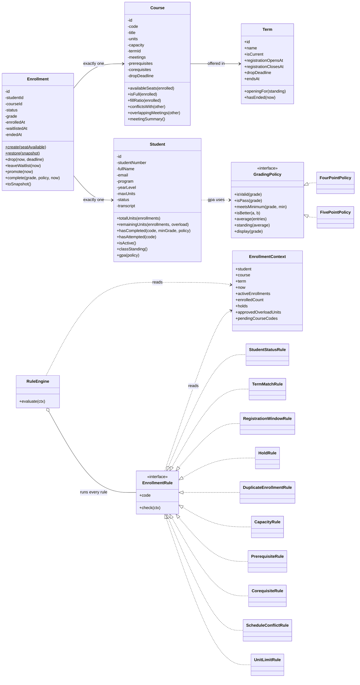
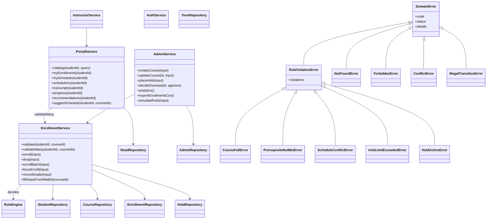
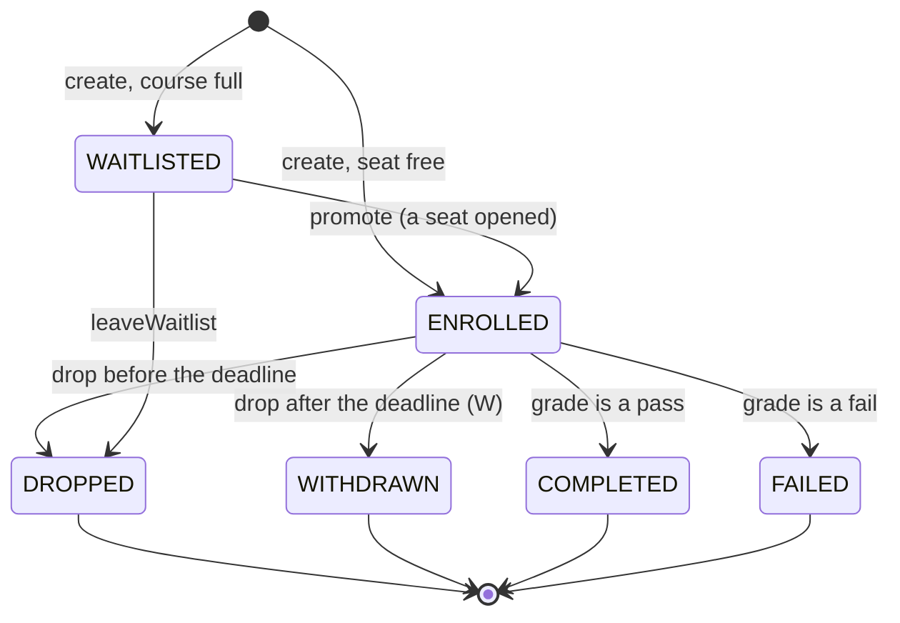

# Class diagram

How the code is organised, drawn from the actual classes in `apps/api/src`. Dependencies point downward only:
`http -> services -> (rules, repositories) -> domain`. The domain layer imports no Express and no mysql2.

## Domain, rules, and strategies

Notes for the oral defense:

- `Enrollment` is the **association class**: one student, one course. Many-to-many lives in this class.
- Fields are ES private (`#field`) with getters, so `status` can only change through `drop`, `promote`, `leaveWaitlist`, or `complete`.
- Adding a business rule means adding one class that implements `EnrollmentRule`. No existing rule changes (open/closed principle).
- Grading is a second strategy: nothing outside `GradingPolicy` knows whether a higher or lower grade is better.

## Services, repositories, and errors

The error middleware maps every `DomainError` to `{ error: { code, message, details } }`. The `code` is stable, so the UI switches on it and never on message text.

## Enrollment state machine

All other transitions throw `IllegalTransitionError`.

