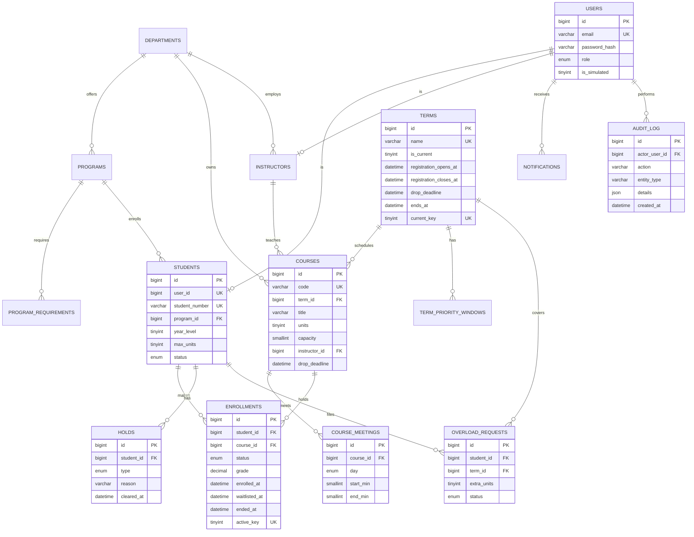

# Entity-relationship diagram

Schema from `apps/api/src/db/migrations/001_reference.sql` to `004_activity.sql`. MySQL 8, InnoDB, `utf8mb4`, all timestamps UTC `DATETIME(3)`.

Also in the schema, but drawn without relationships to keep the diagram readable:

- `prerequisites(course_code, prereq_code, min_grade)` and `corequisites(course_code, coreq_code)`. These are keyed by catalog **code**, not offering id, because a requirement holds in every term.
- `notifications`, `announcements`, `instructors`, `programs`, `program_requirements`, `term_priority_windows`, `departments`.
- `schema_migrations(version)`, written by the migration runner.

## Design decisions worth explaining

**One active enrollment per student per course.** MySQL has no partial unique index, so `enrollments.active_key` is a generated column: `1` when the status is `ENROLLED` or `WAITLISTED`, otherwise `NULL`. `UNIQUE (student_id, course_id, active_key)` then forbids two active rows, while any number of `DROPPED` rows (where `active_key` is `NULL`) is allowed, because NULLs never collide in a unique key. A student can drop and re-enroll; they can never be enrolled twice.

**Exactly one current term.** Same trick: `terms.current_key` is `1` for the current term and `NULL` otherwise, with a unique key.

**Waitlist position is derived, never stored.** It is the rank of `(waitlisted_at, id)` among waitlisted rows for the course. Nothing needs renumbering when someone drops.

**Seat counts are `COUNT(*)`, not a counter column.** There is no second number that could drift out of sync with the rows, and the course row lock already serialises every writer.

**CHECK constraints** enforce `capacity >= 0`, `units > 0`, `end_min > start_min`, and a `WAITLISTED` row must have `waitlisted_at`.
